






I am a PhD Candidate at <a href="https://mip.postech.ac.kr/" style="color: #7289da; text-decoration: none;">MIP Lab</a> at Pohang University of Science and Technology (POSTECH), currently advised by Prof. <a href="https://wwplato.github.io/" style="color: #7289da; text-decoration: none;">Won Hwa Kim</a>. If you are interested in collaborating with me on research projects, please contact me! Here is my <a href="https://www.overleaf.com/read/pymdkzbhfqmn#9a5666" style="color: #7289da; text-decoration:none">CV</a>.

My primary research interest includes:
- Generative AI
- Medical Imaging
- Graph Machine Learning

# 🔥 News
- *2026.08*: &nbsp;🎉🎉 A paper accepted to **EMNLP Findings 2026**.
- *2026.06*: &nbsp;🎉🎉 A paper accepted to **ECCV 2026**.
- *2026.06*: &nbsp;🎉🎉 2 papers in total accepted to **MICCAI 2026**
- *2026.05*: &nbsp;🎉🎉 A paper accepted to **MICCAI 2026** (early accepted, top 9%).
- *2026.02*: &nbsp;🎉🎉 A paper accepted to **CVPR 2026** 
- *2026.02*: &nbsp;🎊🎊 Won the Bronze prize in Samsung Humantech Paper Award.
- *2026.02*: &nbsp;🎊🎊 Won the Silver prize in 38th Workshop on Image Processing and Image Understanding (IPIU).
- *2026.01*: &nbsp;🎊🎊 Won the Excellence paper award from the Graduate School of AI, POSTECH.
- *2025.11*: &nbsp;🎊🎊 Won the POSTECHIAN Fellowship.
- *2025.06*: &nbsp;🎉🎉 A paper accepted to **MICCAI 2025** (early accepted, top 9%).
- *2025.01*: &nbsp;🎉🎉 A paper accepted to **ICLR 2025**
- *2024.05*: &nbsp;🤘🤘 Passed Qual Exam! Now, I'm a **Ph.D Candidate**!
- *2024.05*: &nbsp;🎉🎉 A paper accepted to **MICCAI 2024** (early accepted, top 11%).
- *2023.09*: &nbsp;🎉🎉 A paper accepted to **NeurIPS 2023**
- *2022.08*: &nbsp;🤘🤘 Excited to start my Ph.D. program at **POSTECH**! 

# 📝 Publications
<table class="pub-table" style="border-collapse:collapse; border:none; width:100%;">
  <tr style="border:none;">
    <td style="width:260px; vertical-align:top; border:none; padding:8px 0;">
      

        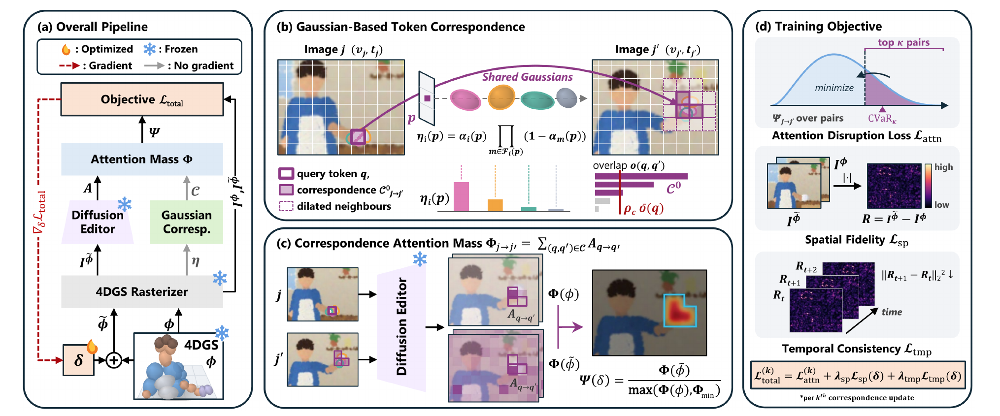
      

    </td>
    <td style="vertical-align:top; border:none; padding-left:16px; width:75%;">
      <strong>TrajGuard: Immunizing 4D Gaussian Splatting Against Text-Guided Editing via Trajectory-Anchored Correspondence Disruption</strong> 
      <a href="https://about:blank">[paper]</a> 
      <strong>Minjae Jeong</strong>, Seungjoo Lee, Won Hwa Kim 
      UnderReview 
    </td>
  </tr>

  <tr style="border:none;">
    <td style="width:260px; vertical-align:top; border:none; padding:8px 0;">
      

        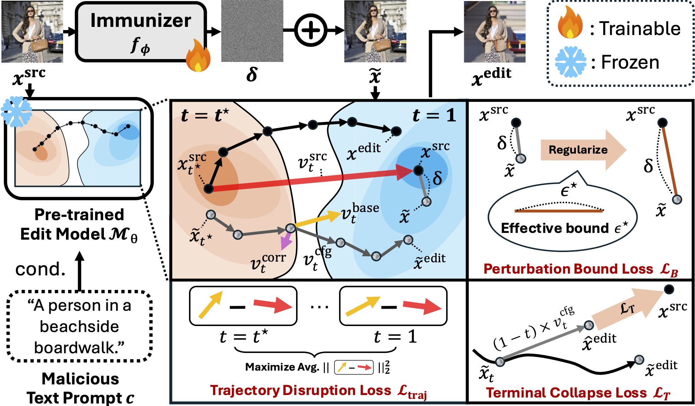
      

    </td>
    <td style="vertical-align:top; border:none; padding-left:16px; width:75%;">
      <strong>GuardFlow: Image Immunization via Trajectory Disruption against Flow-Based Image Editing</strong> 
      <a href="https://about:blank">[paper]</a> 
      Seungjoo Lee*, <strong>Minjae Jeong</strong>*, Jaejin Lee, Won Hwa Kim <em>(* equal contribution)</em> 
      UnderReview 
    </td>
  </tr>
  
  <tr style="border:none;">
    <td style="width:260px; vertical-align:top; border:none; padding:8px 0;">
      

        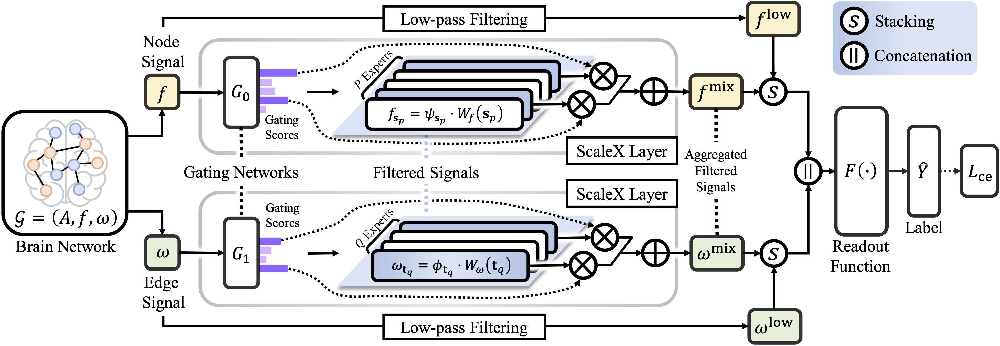
      

    </td>
    <td style="vertical-align:top; border:none; padding-left:16px; width:75%;">
      <strong>Mixture of Spectral Wavelets on Simplicial Complex: Analysis of Brain Connectome with Neurodegeneration</strong> 
      <a href="https://about:blank">[paper]</a> 
      Yechan Hwang*, <strong>Minjae Jeong</strong>*, Jaeyoon Sim, Won Hwa Kim <em>(* equal contribution)</em> 
      UnderReview 
      <mark class="purple">Bronze prize at 32th Samsung Humantech Paper Award</mark>
    </td>
  </tr>

  <tr style="border:none;">
    <td style="width:260px; vertical-align:top; border:none; padding:8px 0;">
      

        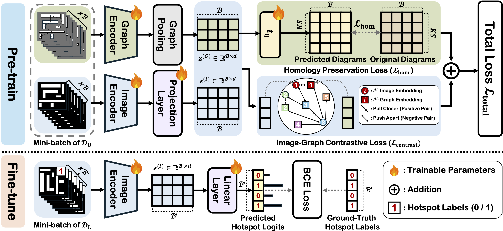
      

    </td>
    <td style="vertical-align:top; border:none; padding-left:16px; width:75%;">
      <strong>TopoGIP: Topology-Aware Graph-Image Pre-training for Lithography Hotspot Detection</strong> 
      <a href="https://about:blank">[paper]</a> 
      Jaejin Lee*, Yechan Hwang*, <strong>Minjae Jeong</strong>*, Won Hwa Kim <em>(* equal contribution)</em> 
      UnderReview 
    </td>
  </tr>

  <tr style="border:none;">
    <td style="width:260px; vertical-align:top; border:none; padding:8px 0;">
      

        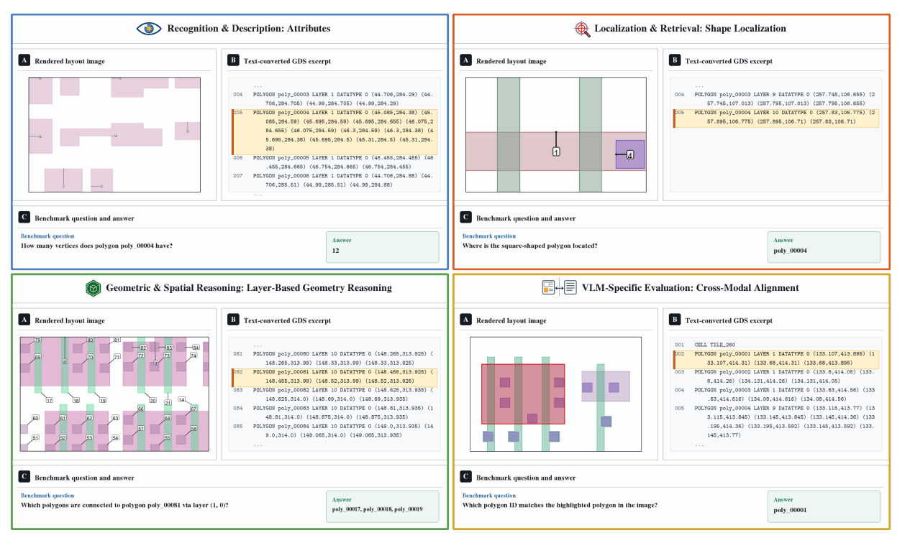
      

    </td>
    <td style="vertical-align:top; border:none; padding-left:16px; width:75%;">
      <strong>ChipLayoutBench: A Multimodal Benchmark for Vision-Language Models in Semiconductor Layout Understanding</strong> 
      <a href="https://aclanthology.org/2026.findings-emnlp.1569.pdf">[paper]</a> 
      Serim Ryou, Jayeon Yoo, <strong>Minjae Jeong</strong>, Won Hwa Kim, Seong-Jin Park 
      EMNLP 2026 (Findings)
    </td>
  </tr>

  <tr style="border:none;">
    <td style="width:260px; vertical-align:top; border:none; padding:8px 0;">
      

        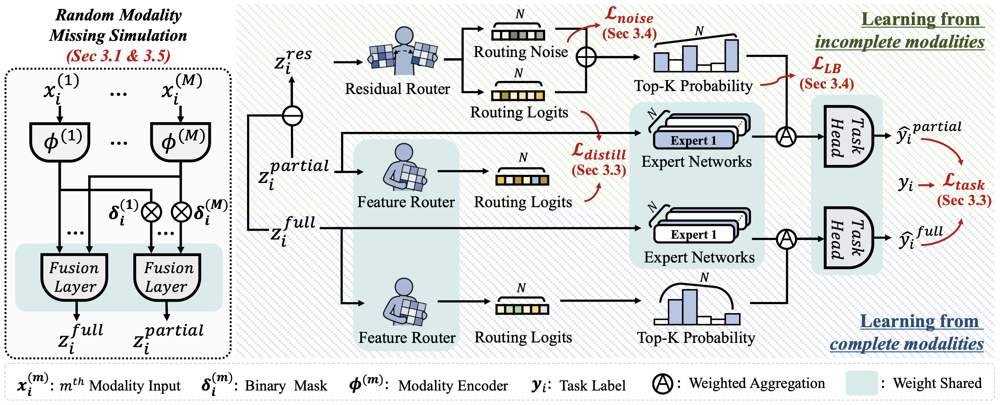
      

    </td>
    <td style="vertical-align:top; border:none; padding-left:16px; width:75%;">
      <strong>Residual-Guided Expert Specialization for Incomplete Multimodal Learning</strong> 
      <a href="https://arxiv.org/pdf/2606.30355">[paper]</a> <a href="https://github.com/seunghub/MARS">[code]</a> 
      Seunghun Baek, Jihwan Park, Jaeyoon Sim, <strong>Minjae Jeong</strong>, Hoseok Lee, Won Hwa Kim 
      ECCV 2026 
      <mark class="purple">Bronze prize at 38th Workshop on Image Processing and Image Understanding (IPIU)</mark>
    </td>
  </tr>

  <tr style="border:none;">
    <td style="width:260px; vertical-align:top; border:none; padding:8px 0;">
      

        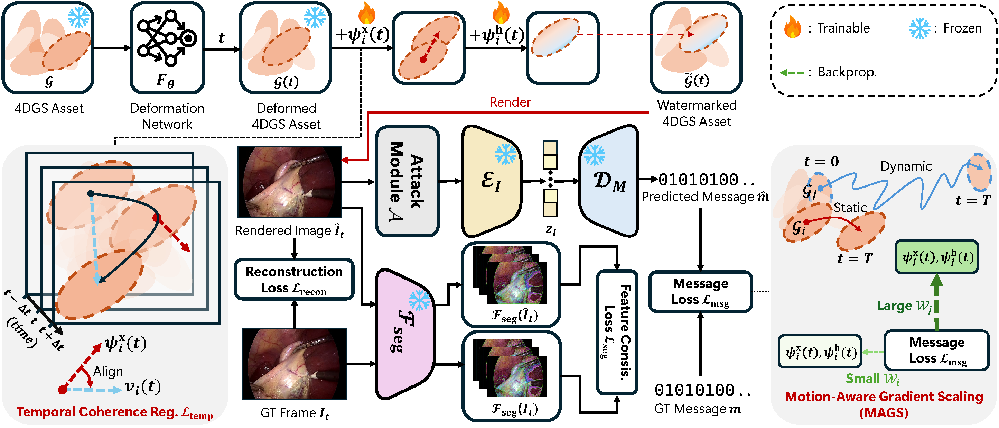
      

    </td>
    <td style="vertical-align:top; border:none; padding-left:16px; width:75%;">
      <strong>SurgMark: Structure-Aware Watermarking for 4D Gaussian Splatting in Surgical Scenes</strong> 
      <a href="https://papers.miccai.org/miccai-2026/paper/2259_paper.pdf">[paper]</a> <a href="https://github.com/minjaetidtid/SurgMark">[code]</a> 
      <strong>Minjae Jeong</strong>*, Jaejin Lee*, Yechan Hwang, Won Hwa Kim <em>(* equal contribution)</em> 
      MICCAI 2026
    </td>
  </tr>
  
  <tr style="border:none;">
    <td style="width:260px; vertical-align:top; border:none; padding:8px 0;">
      

        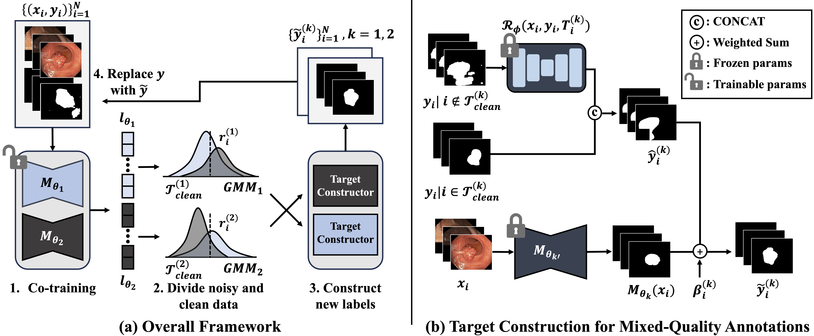
      

    </td>
    <td style="vertical-align:top; border:none; padding-left:16px; width:75%;">
      <strong>Learning Robust Medical Image Segmentation under Mixed-Quality Annotations</strong> 
      <a href="https://papers.miccai.org/miccai-2026/paper/2250_paper.pdf">[paper]</a> <a href="https://github.com/minjaetidtid/RGSS">[code]</a> 
      <strong>Minjae Jeong</strong>*, Seungjoo Lee*, Jaejin Lee, Won Hwa Kim <em>(* equal contribution)</em> 
      MICCAI 2026 (Early Accept: ~9%)
    </td>
  </tr>
  
  <tr style="border:none;">
    <td style="width:260px; vertical-align:top; border:none; padding:8px 0;">
      

        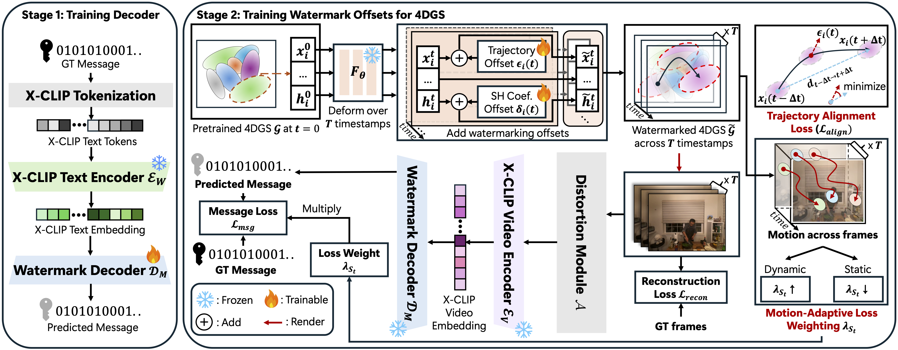
      

    </td>
    <td style="vertical-align:top; border:none; padding-left:16px; width:75%;">
      <strong>Mark4D: Temporally-Consistent Watermarking for 4D Gaussian Splatting</strong> 
      <a href="https://openaccess.thecvf.com/content/CVPR2026/papers/Lee_Mark4D_Temporally-Consistent_Watermarking_for_4D_Gaussian_Splatting_CVPR_2026_paper.pdf">[paper]</a> <a href="https://github.com/minjaetidtid/Mark4D">[code]</a> 
      Jaejin Lee*, <strong>Minjae Jeong</strong>*, Joonhyuk Park, Yechan Hwang, Seunghun Baek, Won Hwa Kim <em>(* equal contribution)</em> 
      CVPR 2026 
      <mark class="purple">Silver prize at 38th Workshop on Image Processing and Image Understanding (IPIU)</mark>
    </td>
  </tr>

 <tr style="border:none;">
    <td style="width:260px; vertical-align:top; border:none; padding:8px 0;">
      

        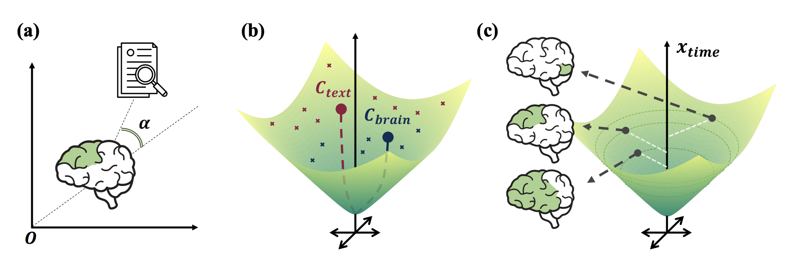
      

    </td>
    <td style="vertical-align:top; border:none; padding-left:16px; width:75%;">
      <strong>MNM: Multi-level Neuroimaging Meta-analysis with Hyperbolic Brain-Text Representations</strong> 
      <a href="https://papers.miccai.org/miccai-2025/paper/0365_paper.pdf">[paper]</a> <a href="https://github.com/seunghub/Multi-level-Neuroimaging-Meta-analysis">[code]</a> 
      Seunghun Baek, Jaejin Lee, Jaeyoon Sim, <strong>Minjae Jeong</strong>, Won Hwa Kim 
      MICCAI 2025 (Early Accept: ~9%)
    </td>
  </tr>

  <tr style="border:none;">
    <td style="width:260px; vertical-align:top; border:none; padding:8px 0;">
      

        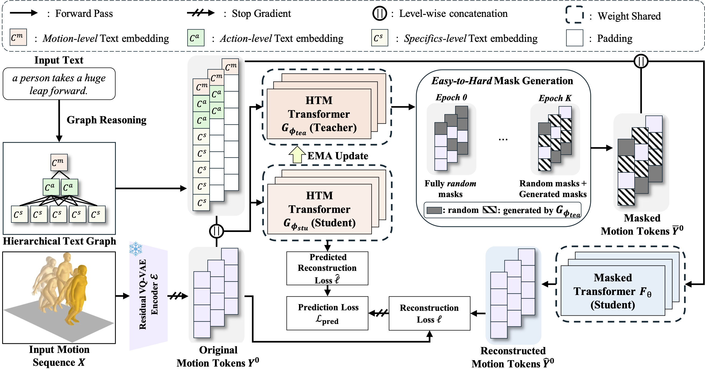
      

    </td>
    <td style="vertical-align:top; border:none; padding-left:16px; width:75%;">
      <strong>HGM³: Hierarchical Generative Masked Motion Modeling with Hard Token Mining</strong> 
      <a href="https://proceedings.iclr.cc/paper_files/paper/2025/file/df96de50d1d206d7d693603481112104-Paper-Conference.pdf">[paper]</a> <a href="https://github.com/minjaetidtid/HGM3">[code]</a> 
      <strong>Minjae Jeong</strong>*, Yechan Hwang*, Jaejin Lee, Sungyoon Jung, Won Hwa Kim <em>(* equal contribution)</em> 
      ICLR 2025 
      <mark class="purple">Excellence paper award from the Graduate School of AI, POSTECH</mark>
    </td>
  </tr>

 <tr style="border:none;">
    <td style="width:260px; vertical-align:top; border:none; padding:8px 0;">
      

        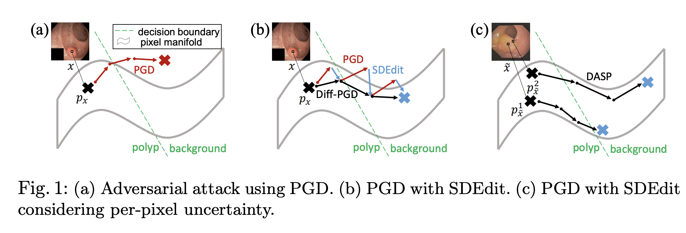
      

    </td>
    <td style="vertical-align:top; border:none; padding-left:16px; width:75%;">
      <strong>Uncertainty-aware Diffusion-based Adversarial Attack for Realistic Colonoscopy Image Synthesis</strong> 
      <a href="https://papers.miccai.org/miccai-2024/paper/2811_paper.pdf">[paper]</a> <a href="https://github.com/minjaetidtid/DASP">[code]</a> 
      <strong>Minjae Jeong</strong>*, Hyuna Cho*, Sungyoon Jung, Won Hwa Kim <em>(* equal contribution)</em> 
      MICCAI 2024 (Early Accept: ~11%)
    </td>
  </tr>

 <tr style="border:none;">
    <td style="width:260px; vertical-align:top; border:none; padding:8px 0;">
      

        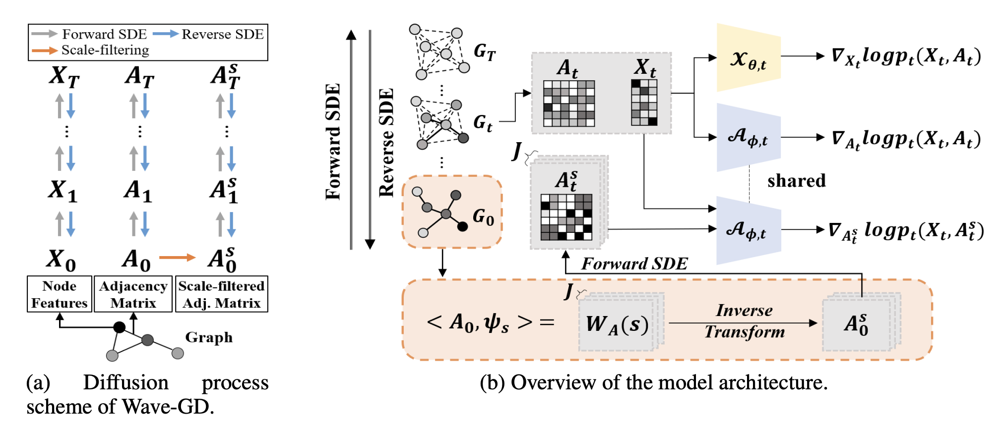
      

    </td>
    <td style="vertical-align:top; border:none; padding-left:16px; width:75%;">
      <strong>Multi-resolution Spectral Coherence for Graph Generation with Score-based Diffusion</strong> 
      <a href="https://proceedings.neurips.cc/paper_files/paper/2023/file/427f20d90386fd27804f1831d6a3d48f-Paper-Conference.pdf">[paper]</a> 
      Hyuna Cho, <strong>Minjae Jeong</strong>, Sooyeon Jeon, Sungsoo Ahn, Won Hwa Kim 
      NeurIPS 2023
    </td>
  </tr>
</table>

<!--#
- Mitigating Over-Squashing in Brain Networks: Curvature-Adaptive Rewiring with Biological Gating 
[[paper]](https://about:blank) \
Yechan Hwang, Jaeyoon Sim, **Minjae Jeong**, Won Hwa Kim \
Under review

- Residual-Guided Expert Specialization for Incomplete Multimodal Learning 
[[paper]](https://about:blank) \
Seunghun Baek, Jihwan Park, Jaeyoon Sim, **Minjae Jeong**, Hoseok Lee, Won Hwa Kim  \
Under review \
<mark class="purple">Bronze prize at 38th Workshop on Image Processing and Image Understanding (IPIU)</mark>
-->

<!--#
- Uncertainty-aware Diffusion-based Adversarial Attack for Realistic Colonoscopy Image Synthesis
[[paper]](https://papers.miccai.org/miccai-2024/809-Paper2811.html) \
**Minjae Jeong** *, Hyuna Cho *, Sungyoon Jung, Won Hwa Kim (\*: equal contribution) \
Medical Image Computing and Computer Assisted Intervention **(MICCAI)** 2024 [**Early Accept**: ~11%]

- Multi-resolution Spectral Coherence for Graph Generation with Score-based Diffusion 
[[paper]](https://neurips.cc/virtual/2023/poster/70356) \
Hyuna Cho, **Minjae Jeong**, Sooyeon Jeon, Sungsoo Ahn, Won Hwa Kim \
Neural Information Processing Systems **(NeurIPS)** 2023
-->
<!--# 🎖 Honors and Awards
- *2021.10* Lorem ipsum dolor sit amet, consectetur adipiscing elit. Vivamus ornare aliquet ipsum, ac tempus justo dapibus sit amet. 
- *2021.09* Lorem ipsum dolor sit amet, consectetur adipiscing elit. Vivamus ornare aliquet ipsum, ac tempus justo dapibus sit amet. -->

# 📖 Educations
- *2022.09 - Present*, Ph.D. in Graduate School of Artificial Intelligence, <a href="https://www.postech.ac.kr/eng/" style="color: #7289da; text-decoration: none;">POSTECH</a>.
- *2018.03 - 2022.08*, B.S. in Electrical Engineering and Computer Science, <a href="https://www.gist.ac.kr/en/main.html" style="color: #7289da; text-decoration: none;">GIST</a>.
- *2016.03 - 2018.02*, <a href="https://jeonnam-sh.jge.hs.kr/chonnam-sh_hs/main.do?sysId=chonnam-sh_hs" style="color: #7289da; text-decoration: none;">Jeonnam Science High School</a>, a high school for students gifted in math and science (early graduation).

<!--# 💬 Invited Talks
- *2021.06*, Lorem ipsum dolor sit amet, consectetur adipiscing elit. Vivamus ornare aliquet ipsum, ac tempus justo dapibus sit amet. 
- *2021.03*, Lorem ipsum dolor sit amet, consectetur adipiscing elit. Vivamus ornare aliquet ipsum, ac tempus justo dapibus sit amet.  \| [\[video\]](https://github.com/)-->

# 💻 Work Experience
- *2021.09 - 2022.08*, Undergraduate Research Intern at <a href="https://jeanyson.github.io/lab/" style="color: #7289da; text-decoration: none;">ViRL-Lab</a>, GIST, Gwangju, South Korea. Prof: <a href="https://jeanyson.github.io/" style="color: #7289da; text-decoration: none;">Jeany Son</a>
- *2021.06 - 2021.08*, Undergraduate Intern at <a href="https://about:blank" style="color: #7289da; text-decoration: none;">Creaty</a>, Gwangju, South Korea.
- *2019.04 - 2019.07*, Undergraduate Intern at <a href="https://open.shinhansec.com/new_eng/" style="color: #7289da; text-decoration: none;">Shinhan Securities</a>, FICC Team, Seoul, South Korea.

# 👨‍🏫 Teaching Experience
- *2025.08 - 2025.09*, Teaching Assistant for AI & Big Data Academy (MOOC) at <a href="https://www.posco.co.kr/homepage/docs/eng7/jsp/s91a0000001i.jsp" style="color: #7289da; text-decoration: none;">POSCO</a>, Pohang, Republic of Korea.
- *2024.08 - 2024.12*, Teaching Assistant for Programming & Problem solving (CSED101) at <a href="https://www.postech.ac.kr/eng/" style="color: #7289da; text-decoration: none;">POSTECH</a>, Pohang, Republic of Korea.
- *2023.06*, Teaching Assistant for AI & Big Data Academy at <a href="https://www.posco.co.kr/homepage/docs/eng7/jsp/s91a0000001i.jsp" style="color: #7289da; text-decoration: none;">POSCO</a>, Pohang, Republic of Korea.
- *2023.02 - 2023.06*, Teaching Assistant for Data Structure class (CSE/CSED233) at <a href="https://www.postech.ac.kr/eng/" style="color: #7289da; text-decoration: none;">POSTECH</a>, Pohang, Republic of Korea.
- *2022.03 - 2022.06*, Teaching Assistant for Object-Oriented Programming class (EECS/GS2408) at <a href="https://www.gist.ac.kr/en/main.html" style="color: #7289da; text-decoration: none;">GIST</a>, Gwangju, Republic of Korea.
- *2021.09 - 2021.12*, Teaching Assistant for Computer programming class (EECS/GS1401) at <a href="https://www.gist.ac.kr/en/main.html" style="color: #7289da; text-decoration: none;">GIST</a>, Gwangju, Republic of Korea.

# 👩‍💻 Academic Service
- *Reviewer*: CVPR (2026), ECCV (2026), MICCAI (2026), ICLR RSI Workshop (2026), NeurIPS (2026), AAAI (2026), ICLR (2027)
